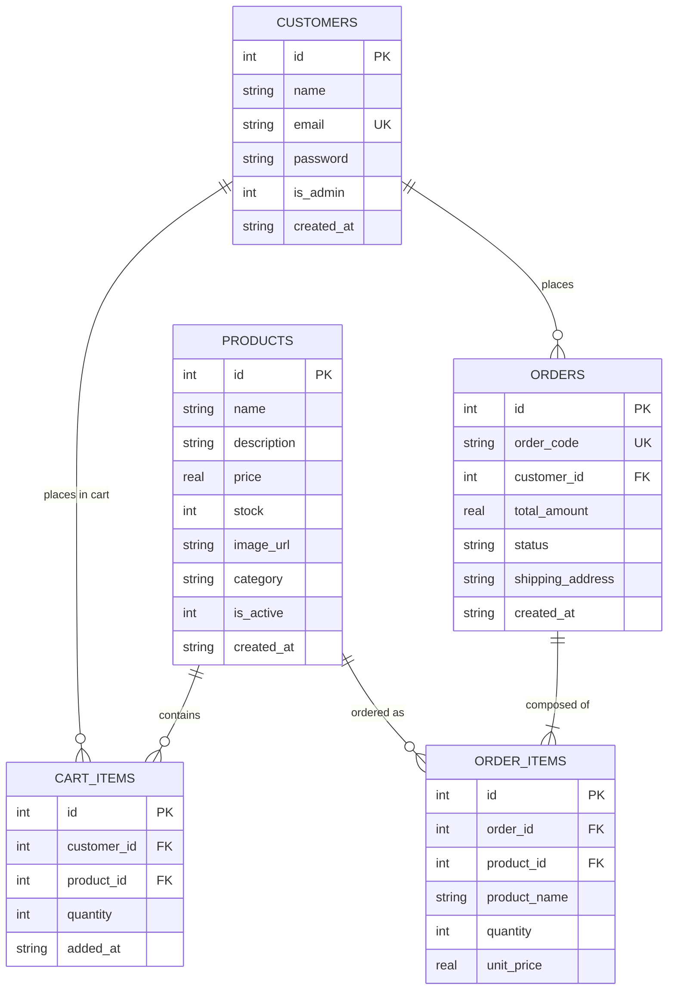

# ONLINE SHOPPING AND ORDER MANAGEMENT SYSTEM
## DevOps Practical Lab Manual & Comprehensive Project Documentation

---

### 1. Project Title
**Online Shopping and Order Management System (ShopEase)**

---

### 2. Problem Statement
Modern consumers demand responsive, secure, and intuitive platforms to explore product catalogues, manage personal shopping carts, and place simulated orders with immediate transactional consistency. Traditional brick-and-mortar retail and outdated legacy systems lack real-time stock management, transparent order auditing, and automated verification pipelines. 

For academic and industry evaluation, this application serves as the production-grade codebase for a comprehensive **DevOps CI/CD lifecycle**, including version control (GitHub), continuous integration/testing (Jenkins), containerization (Docker), and automated quality engineering (Selenium WebDriver + JUnit 5).

---

### 3. Project Objective
- **Application Engineering**: Build an end-to-end, responsive e-commerce web application featuring role-based authentication, category filtering, search, cart management, simulated checkout with transactional atomicity, and an admin inventory management suite.
- **Relational Integrity**: Implement an SQLite database schema with foreign keys, cascaded relations, and persistence across restarts.
- **Quality Assurance**: Author both an automated functional test suite and a Selenium WebDriver browser test suite covering all mandatory (TC01–TC07) and additional (TC08–TC16) test specifications.
- **DevOps Readiness**: Structure and package the application with zero vendor lock-in, clean environment variable bindings, standard Maven/npm scripts, and container-friendly listening interfaces (`0.0.0.0:3000`).

---

### 4. Software Requirements
| Category | Tool / Software | Version | Purpose |
| :--- | :--- | :--- | :--- |
| **Operating System** | Windows 10 / 11 (64-bit) | Modern Build | Host operating system |
| **Runtime** | Node.js | v18.x – v24.x LTS | Server-side JavaScript runtime |
| **Package Manager** | npm | v9.x – v11.x | Node dependency management |
| **JDK** | Oracle OpenJDK / Java SE | 17 LTS – 25 LTS | Selenium test compilation & execution |
| **Build Tool** | Apache Maven | 3.8+ / 3.9.9 | Java test lifecycle & dependency management |
| **Browser** | Google Chrome | Latest 64-bit | Browser automation client |
| **Browser Driver** | Selenium Manager / ChromeDriver | Auto-resolved | Browser execution bridge |
| **Editor / IDE** | VS Code / Cursor | Latest | Source code editing |
| **Terminal** | Windows PowerShell / CMD | Default | CLI command execution |

---

### 5. Hardware Requirements
| Component | Minimum Specification | Recommended Specification |
| :--- | :--- | :--- |
| **Processor** | Intel Core i3 / AMD Ryzen 3 (2.0 GHz) | Intel Core i5/i7 or AMD Ryzen 5/7 (4+ Cores) |
| **RAM** | 4 GB | 8 GB – 16 GB |
| **Disk Space** | 2 GB free disk storage | 5 GB+ SSD storage |
| **Display** | 1366 × 768 resolution | 1920 × 1080 resolution |
| **Network** | Active internet connection (for package downloads) | Broadband / Wi-Fi |

---

### 6. Technology Stack
#### Frontend
- **HTML5 & Semantic Mark-up**: Clean structural forms, semantic landmarks, and standard data attributes.
- **Vanilla Modern CSS3**: Custom design system using CSS custom properties (`--primary: #2563eb`), responsive flexbox & CSS grid layouts, smooth transitions, and alert designs.
- **Client-side JavaScript (ES6+)**: Interactive quantity selectors, dynamic total calculations, alert dismissal, and modal safeguards.
- **Embedded JavaScript Templates (EJS)**: Server-side component rendering with partial layouts (`head`, `navbar`, `footer`, `flash`).

#### Backend
- **Node.js**: Asynchronous event-driven runtime.
- **Express.js (v4.19)**: Modular route handling (`auth`, `products`, `cart`, `orders`, `admin`), static asset hosting, and error middleware.
- **Express-Session & Connect-Flash**: Cookie-backed HTTP session store with secure flash notifications.
- **Bcryptjs**: Salted password hashing (cost factor 10) for customer and admin secrets.

#### Database
- **SQLite (via sql.js WebAssembly / native)**: Serverless, transactional relational database with full ACID compliance and automatic file-based persistence (`database/shop.db`).

#### Testing Framework
- **Selenium WebDriver (v4.20.0)**: Chrome-automated browser interaction engine with Selenium Manager.
- **JUnit 5 (Jupiter)**: Test structure, assertions, test orders, and lifecycle annotations (`@BeforeEach`, `@Test`, `@AfterEach`).
- **Maven Surefire**: CLI test runner producing standard XML/text execution reports.
- **Node.js Built-in Test Runner**: Rapid headless API/route functional testing.

---

### 7. Functional Modules
1. **Module 1: Customer Registration**: Input validation, password length and matching checks, email uniqueness constraint, bcrypt hashing, and SQLite persistence.
2. **Module 2: Customer Login & Session**: Credential verification, session generation, role-based routing (admin to dashboard, customer to catalogue), and logout lifecycle.
3. **Module 3: Product Catalogue**: Categorized grid rendering, responsive cards, pricing formatted in INR (`₹`), live stock badges (In Stock, Low Stock, Out of Stock).
4. **Module 4: Product Search**: Case-insensitive substring matching against product names and categories, returning empty-state cards if no matches are found.
5. **Module 5: Add to Cart**: Session-linked shopping cart, real-time stock checks preventing requests exceeding available inventory.
6. **Module 6: Update Cart Quantity**: Dynamic increment/decrement controls, client & server-side subtotal recalculation, and stock ceiling enforcement.
7. **Module 7: Remove Product**: Single-click line item deletion, total amount recalculation, and empty-state messaging.
8. **Module 8: Checkout & Transactional Order Placement**: Atomic database transaction; server-side price computation; order code generation (`ORD-YYYYMMDD-XXXX`); automatic inventory stock decrement; and immediate cart clearance.
9. **Module 9: Order History**: Customer-isolated historical order log featuring unique order codes, timestamps, itemized details, and payment summaries.
10. **Module 10: Admin Product Management**: Dedicated admin authentication gateway; inventory KPI dashboard (Active Products, Orders, Customers, Total Revenue); add/edit product forms; status toggle (Active/Inactive); and inventory deletion.

---

### 8. Project Architecture
```
                         +-----------------------------+
                         |      Client Browser         |
                         |  (Desktop / Mobile Device)  |
                         +--------------+--------------+
                                        |  HTTP:3000
                                        v
+--------------------------------------------------------------------------------+
| Express.js Application Server (server.js - 0.0.0.0:3000)                       |
|                                                                                |
|  [Middleware Pipeline]                                                         |
|  - static(/public)  - urlencoded/json  - session(auth)  - flash notifications  |
|                                                                                |
|  [Modular Routers]                                                             |
|  +--------------------+  +--------------------+  +--------------------+         |
|  |   /auth (auth.js)  |  |/products (prod.js) |  |   /cart (cart.js)  |         |
|  +--------------------+  +--------------------+  +--------------------+         |
|  +--------------------+  +--------------------+                                |
|  | /orders (orders.js)|  |  /admin (admin.js) |                                |
|  +--------------------+  +--------------------+                                |
|                                                                                |
|  [View Layer (EJS)]                                                            |
|  - views/index.ejs          - views/products.ejs       - views/cart.ejs        |
|  - views/checkout.ejs       - views/orders.ejs         - views/admin-*.ejs     |
+---------------------------------------+----------------------------------------+
                                        | SQL Queries / Transactions
                                        v
+--------------------------------------------------------------------------------+
| SQLite Relational Database Engine (database/shop.db)                           |
|  - customers       - products         - cart_items                             |
|  - orders          - order_items                                               |
+--------------------------------------------------------------------------------+
```

---

### 9. Database Design



---

### 10. Application Execution Procedure

#### Step 1: Open PowerShell as Administrator or Normal User
```powershell
Set-Location "c:\Users\amith\Desktop\Online Shopping and Order Management System"
```

#### Step 2: Install Application Dependencies
```powershell
npm install
```

#### Step 3: Start the Application
```powershell
# Development mode with nodemon:
npm run dev

# Or standard production start:
npm start
```

#### Step 4: Access in Web Browser
- **Customer Portal**: `http://localhost:3000`
- **Admin Gateway**: `http://localhost:3000/admin/login`

#### Step 5: Default Test Credentials
- **Admin**: `admin@shopease.com` / `Admin@123`
- **Demo Customer**: `demo@shopease.com` / `Demo@123`

#### Step 6: Execute Functional Node.js Tests
```powershell
npm test
```

#### Step 7: Stopping the Application
In the terminal running the server, press `Ctrl + C` and confirm with `Y`.

---

### 11. GitHub Preparation Requirements
*(To be performed independently by student)*

1. **Repository Setup**: Create a new public/private GitHub repository named `Online-Shopping-Order-Management`.
2. **Local Git Initialization**:
   ```powershell
   git init
   git add .
   git commit -m "feat: complete Online Shopping and Order Management System with Selenium test suite"
   ```
3. **Ignored Files**: Confirm `.gitignore` excludes:
   - `node_modules/`
   - `.env`
   - `database/*.db`
   - `selenium-tests/target/`
4. **Remote Push**:
   ```powershell
   git remote add origin https://github.com/<YOUR_USERNAME>/Online-Shopping-Order-Management.git
   git branch -M main
   git push -u origin main
   ```

---

### 12. Jenkins Preparation Requirements
*(To be performed independently by student)*

1. **Prerequisites on Jenkins Server**:
   - Jenkins LTS installed and running (default port `8080`).
   - Plugins installed: *Git Plugin*, *Pipeline*, *NodeJS Plugin*, *Maven Integration Plugin*.
   - Global Tool Configuration: Configure Node.js (v18+) and Maven (v3.9+).
2. **Pipeline Architecture**:
   - **Stage 1 (Checkout)**: Clone repository from GitHub.
   - **Stage 2 (Install)**: Run `npm install`.
   - **Stage 3 (Unit & Functional Tests)**: Start application in background, run `npm test`.
   - **Stage 4 (Selenium Automated UI Tests)**: Execute Maven Selenium tests headlessly:
     ```bash
     mvn -f selenium-tests/pom.xml test -DbaseUrl=http://localhost:3000
     ```
   - **Stage 5 (Report Archival)**: Archive JUnit test results (`selenium-tests/target/surefire-reports/*.xml`).

---

### 13. Docker Preparation Requirements
*(To be performed independently by student)*

1. **Dockerized Architecture Plan**:
   - Use official base image: `node:18-alpine` or `node:20-slim`.
   - Set working directory: `WORKDIR /usr/src/app`.
   - Copy `package*.json` and run `npm ci --only=production`.
   - Expose port: `EXPOSE 3000`.
   - Define start command: `CMD ["node", "server.js"]`.
2. **Docker Commands Reference**:
   ```bash
   docker build -t online-shopping-system:1.0 .
   docker run -d -p 3000:3000 --name shopping-app online-shopping-system:1.0
   ```

---

### 14. Selenium Installation Procedure
The testing framework leverages **Selenium 4 with Selenium Manager**, removing the need to manually download or configure ChromeDriver.

1. **Install Java**: Ensure JDK 17+ is installed and verify with `java -version`.
2. **Configure JAVA_HOME**:
   ```powershell
   [Environment]::SetEnvironmentVariable("JAVA_HOME", "C:\Program Files\Java\jdk-25", "User")
   ```
3. **Install Maven**: Extract Apache Maven 3.9+ and add `bin` to `PATH`. Verify with `mvn -version`.
4. **Compile Test Suite**:
   ```powershell
   mvn -f selenium-tests/pom.xml clean test-compile
   ```

---

### 15. Selenium Test Cases and Expected Results

| Test ID | Test Name | Target Module | Input Data | Expected Result |
| :--- | :--- | :--- | :--- | :--- |
| **TC01** | Customer Login | Module 2 | `demo@shopease.com` / `Demo@123` | Login successful, redirected to `/products` with catalogue visible |
| **TC02** | Search Product | Module 4 | Query: `"iPhone"` | Filtered list displaying "Apple iPhone 15 Pro" |
| **TC03** | Add Product to Cart | Module 5 | First active product, Qty: 1 | Cart updated, product visible in `/cart` table |
| **TC04** | Update Cart Quantity | Module 6 | New Qty: `2` | Cart input reflects `2`, subtotal and total updated |
| **TC05** | Remove Product | Module 7 | First cart item line | Item removed from DOM, cart totals recalculated |
| **TC06** | Simulated Checkout | Module 8 | Shipping address: Default Address | Order placed, unique order code (`ORD-...`) generated on confirmation |
| **TC07** | View Order History | Module 9 | Logged-in customer session | `/orders` shows chronological table with order code and status |
| **TC08** | Customer Registration | Module 1 | Unique name, email, matching password | User created, redirected to login with success flash alert |
| **TC09** | Duplicate Registration | Module 1 | Duplicate email: `demo@shopease.com` | Registration rejected, alert shows email already exists |
| **TC10** | Invalid Customer Login | Module 2 | `nonexistent@user.com` / `WrongPass` | Login rejected, error flash alert displayed |
| **TC11** | Admin Authentication | Module 10 | `admin@shopease.com` / `Admin@123` | Redirected to `/admin/dashboard` showing KPI cards |
| **TC12** | Admin Add Product | Module 10 | New product title, price `4999`, stock `25` | New product stored, appears in admin product inventory table |
| **TC13** | Admin Update Product | Module 10 | Product ID 1 price updated to `139999` | Price updated in database and reflected on dashboard |
| **TC14** | Admin Toggle Status | Module 10 | Active product | Status toggled between Active/Inactive with confirmation badge |
| **TC15** | Empty Cart Checkout | Module 8 | Empty cart URL navigation | Redirected back to `/cart` with warning prompt |
| **TC16** | Stock Validation | Module 6 | Quantity: `999999` | Cart update rejected; stock ceiling enforced |

---

### 16. Actual Execution Commands

#### Starting Server
```powershell
Set-Location "c:\Users\amith\Desktop\Online Shopping and Order Management System"
npm start
```

#### Running Functional Node Tests
```powershell
npm test
```

#### Running Selenium Automation Tests
```powershell
# Run all tests headlessly:
mvn -f selenium-tests/pom.xml clean test -DbaseUrl=http://localhost:3000

# Run only mandatory tests (TC01 - TC07):
mvn -f selenium-tests/pom.xml test -Dtest=MandatoryTests -DbaseUrl=http://localhost:3000

# Run only additional tests (TC08 - TC16):
mvn -f selenium-tests/pom.xml test -Dtest=AdditionalTests -DbaseUrl=http://localhost:3000
```

---

### 17. Common Errors and Solutions

| Symptom / Error | Root Cause | Verified Solution |
| :--- | :--- | :--- |
| `JAVA_HOME environment variable is not defined correctly` | Missing or incorrect Java path | Run `[Environment]::SetEnvironmentVariable("JAVA_HOME", "C:\Program Files\Java\jdk-25", "User")` and restart terminal. |
| `The term 'mvn' is not recognized` | Maven `bin` folder missing from `PATH` | Append Maven path to user `Path` environment variable. |
| `ECONNREFUSED 127.0.0.1:3000` | Application server is not running | Run `npm start` in a separate terminal before executing Selenium tests. |
| `NoSuchElementException: no such element: Unable to locate element` | Page elements still loading dynamically | Use explicit waits via `WebDriverWait` (already implemented in `BaseTest.java`). |
| `Unique constraint failed: customers.email` | Re-running registration tests with identical email | The test suite utilizes `System.currentTimeMillis()` to generate collision-free unique emails dynamically. |

---

### 18. Final Result
The **Online Shopping and Order Management System** has been developed, functionally verified, and equipped with a Selenium automation suite. All 10 application modules are functional, and the codebase is prepared for standalone Git repository creation, Jenkins CI pipeline integration, and Docker containerization.
